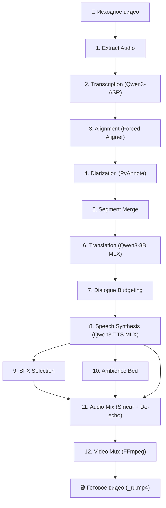

# AI Dubber 🎬🎙️

> **Полный автономный дубляж видео на Apple Silicon (macOS). 100% локально, без облаков и подписок.**

[-black?logo=apple)](https://apple.com)
[](https://python.org)
[](https://fastapi.tiangolo.com)
[](https://github.com/ml-explore/mlx)
[](LICENSE)

AI Dubber — это нативное macOS-приложение и модульный движок дубляжа видео на русском языке. Приложение полностью локально транскрибирует речь, разделяет говорящих, переводит текст с учетом контекста, клонирует голоса и синтезирует русскую речь, накладывая эффекты (SFX) и фоновый эмбиенс.

---

## ✨ Ключевые возможности

- 🖥️ **Нативное macOS-приложение**: компактный Swift + WebKit интерфейс, поддержка Drag & Drop, плавные анимации, индикация этапов и автоматическое управление фоновым сервером.
- 🔒 **100% Offline & Private**: вся обработка выполняется исключительно на вашем Mac через Metal/MPS и Apple MLX. Никакие данные не отправляются на сторонние серверы.
- 🎯 **Умный аудиомикшер («Smear Sequencing»)**:
  - Предотвращение наложений реплик разных персонажей.
  - Алгоритм сглаживания (*smear*): длинные переведённые фразы плавно занимают соседние паузы без неестественного ускорения речи.
  - Защита от обрывов предложений и устранение артефактов эха.
- 🎭 **Диаризация и распределение голосов**: автоматическое определение спикеров (PyAnnote) и генерация индивидуальных тембров через `Qwen3-TTS`.
- 🔊 **Саунд-дизайн (SFX & Ambience)**: автоматический подбор фоновых шумов и звуковых эффектов для реалистичной картины звучания.

---

## 🛠️ Архитектура конвейера (12 этапов)



---

## 💻 Системные требования

- **ОС**: macOS 13.0 (Ventura) или новее.
- **Процессор**: Apple Silicon (M1 / M2 / M3 / M4, рекомендуется Pro / Max / Ultra).
- **Оперативная память**: 16 ГБ RAM (рекомендуется 24+ ГБ для длинных видео).
- **Дисковое пространство**: ~15–20 ГБ для весов локальных моделей.
- **Инструменты**: [Homebrew](https://brew.sh), `ffmpeg`.

---

## 🚀 Установка и запуск

### Вариант 1: Установка через DMG (рекомендуется)

1. Скачайте образ **`AI-Dubber.dmg`** из раздела [Releases](../../releases).
2. Откройте образ и перетащите **AI Dubber.app** в папку **«Программы»** (`/Applications`).
3. Запустите приложение.
4. При первом запуске откроется окно **Настройки моделей**:
   - Введите ваш токен Hugging Face (`HF_TOKEN`) для диаризации PyAnnote.
   - Скачайте необходимые веса моделей в один клик.
5. Перетащите видео в окно приложения и нажмите кнопку старта!

---

### Вариант 2: Запуск из исходного кода (для разработчиков)

#### 1. Клонирование репозитория

```bash
git clone https://github.com/guzhoffivan-hue/AI-Dubbing.git
cd AI-Dubbing
```

#### 2. Первоначальная настройка окружений

Скрипт настроит изолированные виртуальные окружения Python 3.11, установит зависимости и скачает базовые веса:

```bash
./setup
```

#### 3. Сборка нативного приложения и DMG

```bash
# Сборка .app бандла:
./macos/build_app.sh

# Сборка готового DMG установщика:
./macos/build_dmg.sh
```

#### 4. Запуск бэкенда и CLI

```bash
# Запуск API бэкенда:
./api

# Или запуск дубляжа напрямую через CLI:
./dub --test --duration 150
```

---

## 🧪 Тестирование

Проект покрыт полным набором модульных и интеграционных тестов (181 тест):

```bash
# Запуск pytest для ядра:
.venvs/asr/bin/pytest

# Запуск тестов сценариев и инвариантов:
python3 -m unittest discover -s tests
```

---

## 📄 Лицензия

Проект распространяется под лицензией MIT. Подробности в файле [LICENSE](LICENSE).
